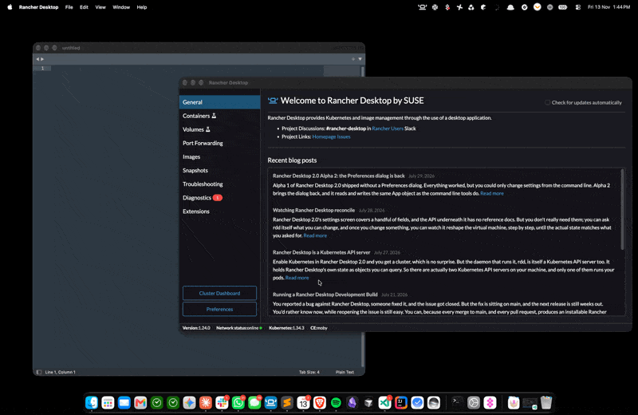

# Dock Click-to-Hide for macOS

**Click to show. Click again to hide.**

Click an already frontmost application's Dock icon to hide it. Other app
activation, modified clicks and drags retain their normal behavior.



## Requirements and distribution limits

- **Apple Silicon only; macOS 13 (Ventura) or later.** The binary is compiled
  explicitly for arm64/macOS 13. Compilation and local `--help` are checked;
  actual macOS 13 Dock/permission behavior has **not** been runtime-tested.
- Releases use **Apple Development signing**, not Developer ID Application,
  and are **not notarized**. A valid signature does not guarantee Gatekeeper
  acceptance. Download quarantine or managed security policy may block execution;
  Homebrew is not a security-policy bypass. Only allow software you trust, using
  normal macOS approval controls. Some managed Macs may not permit it.
- Each Mac needs manual Accessibility approval. Signing never grants consent.

## Homebrew installation

The formula lives in this repository, not a separate tap repository. The explicit
URL is required because the repository name does not start with `homebrew-`.

```sh
brew tap bdombro/macos-dock-click-hide-toggle https://github.com/bdombro/macos-dock-click-hide-toggle.git
brew install bdombro/macos-dock-click-hide-toggle/macos-dock-click-hide-toggle
brew services start bdombro/macos-dock-click-hide-toggle/macos-dock-click-hide-toggle
```

Installing alone does **not** start the service. Start it as your logged-in user,
without `sudo`; the login service runs `macos-dock-click-hide-toggle start`.
Homebrew's generated session types include Aqua but are not Aqua-only; this
formula does not override Homebrew's service generator. Start it only in your
logged-in graphical session, not via a root/system service.

### Accessibility

Open **System Settings > Privacy & Security > Accessibility** (called **Device
Control and Data Access** on some versions). Allow the installed executable,
not merely your terminal. If needed, use **+**, then **Cmd+Shift+G**, and enter
the path printed by:

```sh
echo "$(brew --prefix)/opt/macos-dock-click-hide-toggle/bin/macos-dock-click-hide-toggle"
```

The running service waits for approval without repeated prompts. Bring an app
forward, click its Dock icon to hide it, and click again to show it. If access
still fails, check logs and macOS policy; Accessibility is not a guarantee that
every event-tap/security-policy problem is resolved.

### Restart, update and remove

```sh
brew services restart bdombro/macos-dock-click-hide-toggle/macos-dock-click-hide-toggle

brew update
brew upgrade bdombro/macos-dock-click-hide-toggle/macos-dock-click-hide-toggle
brew services restart bdombro/macos-dock-click-hide-toggle/macos-dock-click-hide-toggle

# Stop before uninstalling:
brew services stop bdombro/macos-dock-click-hide-toggle/macos-dock-click-hide-toggle
brew uninstall bdombro/macos-dock-click-hide-toggle/macos-dock-click-hide-toggle
brew untap bdombro/macos-dock-click-hide-toggle
```

The service writes stdout/stderr to
`$(brew --prefix)/var/log/macos-dock-click-hide-toggle.log`; logs may remain after
uninstall. Updates/path changes may require renewed Accessibility approval even
with the same signing identity. Reapprove the current executable if necessary.

### Migrating from the old local service

From your source checkout, run `just uninstall` (or `bun scripts/install.ts --uninstall`)
**before** starting the Homebrew service. This stops
`local.macos-dock-click-hide-toggle`, removes its private executable and plist,
and preserves `~/.local/share/macos-dock-click-hide-toggle/daemon.log`.
Do not run both services: they would both intercept Dock clicks.

## Local development

Requires Bun, Xcode command-line tools and a valid code-signing identity; `just` is
an optional task runner. There are no third-party runtime dependencies.

```sh
just scripts-typecheck              # bun run tsc --noEmit; no generated output
just build                          # or bun scripts/build.ts
build/bin/macos-dock-click-hide-toggle --help
build/bin/macos-dock-click-hide-toggle --version
just install                        # copies the prebuilt binary; starts at login
just uninstall                      # stops/removes local service, keeps logs
```

Build output is `build/bin/macos-dock-click-hide-toggle`. Build never installs,
starts or restarts anything. Install never builds or signs. Alternatively,
`bun scripts/install.ts /path/to/prebuilt-executable` installs an existing build.
The executable embeds `VERSION` at build time; `--version` prints it, and
`--help` or `-h` prints usage. Release builds embed the new release version.

The build automatically chooses an identity only when exactly one valid Apple
Development, Mac Developer or Developer ID Application identity exists. Otherwise
set `CODE_SIGN_IDENTITY` locally (never commit credentials). Ad-hoc signing is
rejected. The stable signing identifier is `local.macos-dock-click-hide-toggle`;
use the same identity across updates to help preserve approval, without guarantees.
Build and signing are separate function calls in `scripts/build.ts`. For a local
unsigned build, comment out the `sign(output)` call; normal builds and releases should
remain signed.

The local executable is copied to
`~/.local/share/macos-dock-click-hide-toggle/macos-dock-click-hide-toggle`; its
LaunchAgent is `~/Library/LaunchAgents/local.macos-dock-click-hide-toggle.plist`.
Approve that copy for local service use. Local logs are at
`~/.local/share/macos-dock-click-hide-toggle/daemon.log`.

For foreground troubleshooting, stop any installed service first, then run
`build/bin/macos-dock-click-hide-toggle start` and stop with **Ctrl+C**.
Foreground use may attribute permission to your terminal. No runtime source
behavior is changed by the packaging.

## Releases (maintainers)

`VERSION` is canonical; add user-facing notes beneath `## [Unreleased]` in
[CHANGELOG.md](CHANGELOG.md). Release tooling uses Bun,
Git, Ruby (formula syntax check), Apple build/signing tools and authenticated `gh`.
Bun executes the TypeScript scripts directly; `bun install` installs the development
types and TypeScript compiler used by `just scripts-typecheck`. The app runtime
remains Swift with no third-party runtime dependencies.

```sh
just release patch --dry-run        # no file/Git/network mutations
just release minor --yes            # also major or an explicit X.Y.Z
```

A real release requires a clean Git tree (including untracked files), correct
origin and unused version/tag. It builds/signs, promotes Unreleased notes,
archives the binary and license, hashes it and updates the formula. It commits
only VERSION/changelog/formula, tags, atomically pushes branch+tag, then creates
the public GitHub release. Signing may still require local keychain approval;
`--yes` removes the script's confirmation, not OS security prompts.

For initial preparation without Git or network actions:

```sh
just release 0.1.0 --prepare --yes
```

This permits the current version with existing dated notes and writes the actual
signed archive to
`build/release/macos-dock-click-hide-toggle-0.1.0-macos-arm64.tar.gz`,
release notes beside it, and its real SHA-256/public URL to the formula. A future
URL is not downloadable until the matching asset is published. Review source
and ignored files before the initial commit, tag/push and publication.

Failures are not force-retried or rolled back: inspect the reported phase,
working tree, tags and GitHub release before recovery. If push succeeded but
publication failed, create the release from the already pushed tag and exact
prepared asset/notes with `gh release create --verify-tag`; do not bump/rebuild
or overwrite published assets blindly. Keep older release assets available for
older formulas.

## License

[ISC](LICENSE).
